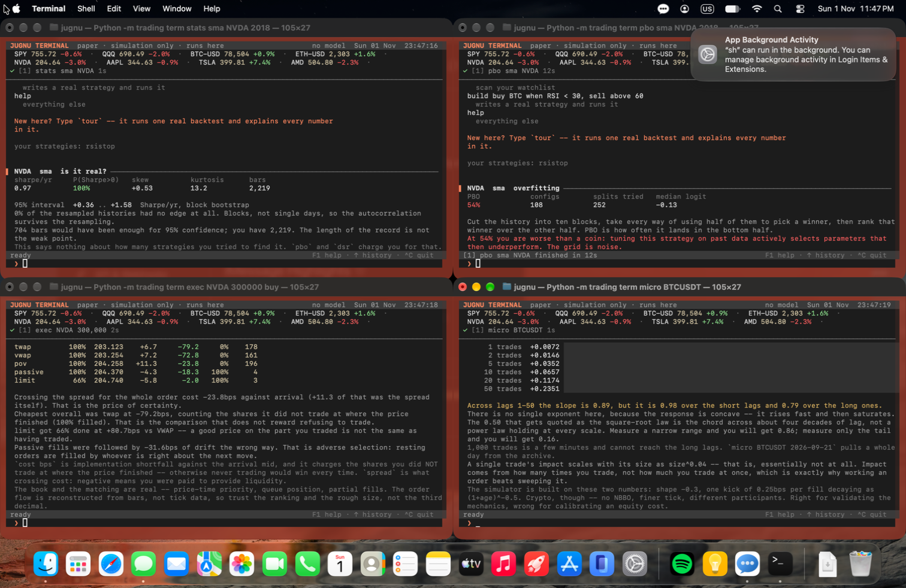

# Jugnu

A macOS menu-bar AI agent that operates the machine — files, Mail, Calendar,
Reminders, Contacts, Safari, WhatsApp, the shell, the keyboard and mouse,
Notion and the web — and a quantitative research terminal built to **reject
trading strategies rather than find them**.

<p align="center">
  
</p>

<p align="center"><em>One tool call: four terminals opened on a second macOS
account, tiled, each running its own analysis. Left to right: is the Sharpe
real, did the parameter search overfit, what would the trade cost to execute,
and a measurement of a live order book.</em></p>

---

## Two things here are unusual

**It has its own computer.** Jugnu runs heavy work in a *second macOS user
account* that it controls over a local HTTP bridge — real GUI, real process
isolation (`drwx------`), live screen streaming back to a window you can take
over. Long sweeps never touch the session you are typing in, and you never
switch user.

**The research terminal argues with you.** Most trading tools help you find
strategies. These are built to disqualify them: probability of backtest
overfitting, a Sharpe deflated by every trial you have *ever* run on that
instrument, purged cross-validation, factor attribution, and an order-book
simulator that charges you for the shares you failed to trade.

| | |
|---|---|
| 201 tools | every one classified into four risk tiers |
| 19 agents | named subsets of the tool surface |
| 52 commands | in the research terminal |
| 339 tests | across 13 modules |
| ~11,500 lines Swift | app + privileged bridge |
| ~28,600 lines Python | backend, tools, research |

---

## Architecture

```
┌─ Jugnu.app ────────────────────────────────── SwiftUI + AppKit ─┐
│  MenuBarController · ContentView · DeskView · AppState          │
│  BackendBridge ──┐                                              │
└──────────────────┼──────────────────────────────────────────────┘
                   │  one JSON object per line, over stdin/stdout
┌──────────────────▼─ bridge.py ─────────────── long-lived Python ┐
│  session.run_turn()  ← the shared spine for every frontend      │
│     fastpath.py  regex   → one tool call, no model at all       │
│     router.py    domain  → one agent, skipping the planner      │
│     planner.py   goal    → task graph           (PLANNER model) │
│     executor.py  graph   → ordered execution                    │
│     agent_core.py        → per-task tool loop   (PLANNER model) │
│     policy.py    201 tools, 4 risk tiers, approvals, audit      │
│  background: ProactiveWatcher · DailyReview · Scheduler         │
└───────┬──────────────────────┬──────────────────────┬───────────┘
        │ HTTP :8765           │ HTTP :8766           │ Ollama, or any
   MacBridge.app          MacBridge.app          OpenAI-compatible API,
   (your session)         (agent account)        or your Claude plan
                                │
                          trading/ — 29 modules, 9,693 lines
```

**The model split is the core idea.** `PLANNER` is the only role that ever
*decides* anything. `AGENT` is deliberately smaller: it renders
already-decided results into prose. Point `JUGNU_PLANNER_MODEL` at something
capable and `JUGNU_MODEL` at something cheap and that split pays off directly.

---

## The research terminal

```bash
python -m trading term                  # or ask Jugnu to open one
```

Fifty-two commands. The ones that matter are the ones that can fail a
strategy:

| | |
|---|---|
| `stats` | probabilistic Sharpe, block-bootstrap interval, the track record the number would need |
| `pbo` | probability of backtest overfitting, by combinatorially symmetric cross-validation |
| `dsr` | Sharpe after paying for **every** backtest ever run on that instrument |
| `search` | that ledger, and the bar it has raised |
| `cv` | purged, embargoed cross-validation |
| `factor` | alpha against market, size, value and momentum, with Newey-West errors |
| `exec` | six execution algorithms through a real matching engine |
| `cap` | fund size before market impact eats the edge |
| `micro` | measure a live order book and tape, and check the model against it |
| `alloc` | equal weight vs inverse variance vs hierarchical risk parity |

Three results it produced about itself, all reproducible:

- An SMA sweep on AAPL since 2015 has **PBO 73%** — picking the best
  parameters in-sample selects a below-median performer out of sample nearly
  three times in four.
- Its order-book simulator reproduces the **square-root impact law** (exponent
  0.58 worked, 1.16 swept, R² 0.99) from a book shape and response function
  *measured* from 400,000 real exchange trades, not assumed.
- Hierarchical risk parity holds the same book at **6.0% annual volatility
  against 8.2% equal-weighted**.

Everything is paper. There is no broker anywhere in the codebase.

---

## Setup

### 1. Python backend

The virtualenv is **not** committed — it isn't relocatable (its `bin/python`
symlinks into Homebrew, and console scripts carry absolute shebangs).

```bash
python3 -m venv PythonBackend/PythonEnv
PythonBackend/PythonEnv/bin/pip install -r PythonBackend/requirements.txt
```

### 2. MacBridge (required)

Roughly 130 of the 201 tools are HTTP calls to a separate helper app. Without
it, Jugnu can hold a conversation but cannot *do* anything.

```bash
cd ../Jarvis/MacBridge && ./build.sh
```

It has its own git repository. Jugnu finds it at, in order:

1. `$JUGNU_MACBRIDGE_PATH`
2. `/Applications/MacBridge.app`
3. `~/Applications/MacBridge.app`
4. `~/Desktop/Jarvis/MacBridge/MacBridge.app`

`AppDelegate` launches it automatically at startup.

On first run macOS will ask for Automation, Accessibility, Screen Recording,
Calendar, Reminders and Contacts. Grant them to **MacBridge**, not to Jugnu —
MacBridge is the process making those calls. `contacts_list` needs *full*
Contacts access; `contacts_search` gets by with limited.

### 3. A model

**Hosted (the default).** Open Settings (⌘,), pick a provider URL and model,
paste an API key. The key goes to the Keychain, never to UserDefaults and
never into Jugnu's own environment.

**Local.** Install [Ollama](https://ollama.com) and pull what you want to run:

```bash
ollama pull qwen3.6:27b        # planner — the one that decides
ollama pull qwen3.5:9b         # agent   — phrasing only, can be small
ollama pull nomic-embed-text   # embeddings for memory recall
```

Settings changes only take effect when the backend restarts — `bridge.py`
and `llm_client.py` read their environment once at import. Settings has a
**Restart Backend to Apply** button for exactly this.

### 4. SearXNG (optional, for web search)

`search_web` expects a SearXNG instance at `http://localhost:8080`. Without
one, web search returns no results and the `research` agent is inert —
everything else works fine.

```bash
docker run -d --name searxng -p 8080:8080 searxng/searxng
```

Its JSON API must be enabled (`search.formats` must include `json` in
`settings.yml`); `search.py` falls back to scraping the HTML endpoint if not.

---

## Where your data lives

`~/Library/Application Support/Jugnu/`

| File | What it holds |
|---|---|
| `conversation.json` | the live transcript (trimmed past 60 messages) |
| `conversation_archive.jsonl` | append-only overflow from the above |
| `user_facts.json` | what `save_fact` has recorded about you |
| `semantic_memory.db` | timeline, search history, activity log, embeddings |
| `temp_email_accounts.json` | disposable inbox credentials |

All plain files. Settings → Privacy reveals the folder and offers **Reset
Facts** and **Reset Memory** separately, since they're different things to
forget. Timeline rows older than `JUGNU_MEMORY_KEEP_DAYS` (180) are pruned at
startup.

---

## Configuration

Settings covers the common cases. Everything else is environment variables.

### Models and providers
| Variable | Default | Meaning |
|---|---|---|
| `JUGNU_PROVIDER` | `api` | `local` (Ollama) or `api` |
| `JUGNU_<ROLE>_PROVIDER` | — | per-role override; roles are `PLANNER`, `AGENT`, `SEARCH`, `EMBED`, `FAST`, `DEEP`, `EASY` |
| `JUGNU_PLANNER_MODEL` | `qwen3.6:27b` | local planner model |
| `JUGNU_MODEL` | `qwen3.5:9b` | local agent model, and search's fallback |
| `JUGNU_EMBED_MODEL` | `nomic-embed-text` | local embedding model |
| `JUGNU_API_BASE_URL` | Gemini's OpenAI-compatible endpoint | any `/chat/completions` provider |
| `JUGNU_API_CHAT_MODEL` | `gemini-3.1-flash-lite` | hosted chat model |
| `JUGNU_API_KEY` | — | or a provider-native var (`OPENAI_API_KEY`, …) |

### Behaviour
| Variable | Default | Meaning |
|---|---|---|
| `JUGNU_ENABLE_AWARENESS` | `1` | let Jugnu see the frontmost app/window |
| `JUGNU_TRACK_ACTIVITY` | `0` | log app + window + duration all day |
| `JUGNU_PROACTIVE` | `0` | allow unprompted messages |
| `JUGNU_PROACTIVE_ACTIONS` | `0` | allow unprompted *actions* — separate opt-in |
| `JUGNU_DAILY_REVIEW` | `0` | scheduled end-of-day recap |
| `JUGNU_MEMORY_KEEP_DAYS` | `180` | timeline retention |
| `NOTION_API_KEY` | — | required by every `notion_*` tool |
| `MACBRIDGE_TOKEN` | — | see below |

---

## Security notes

**MacBridge is unauthenticated by default.** It binds to loopback only,
validates `Host`, and rejects anything carrying `Origin` or `Sec-Fetch-Site`
(so a web page can't reach it). What it does *not* do by default is
distinguish between local processes — its own documented trust model is
"anything running as you." Since it exposes `/shell/run` and
`/applescript/run`, any local process can use it.

To turn on bearer auth, set the same token for both halves:

```bash
launchctl setenv MACBRIDGE_TOKEN "$(openssl rand -hex 32)"
```

`launchctl setenv` puts it in the GUI session environment, so both
MacBridge (launched via NSWorkspace) and `bridge.py` (launched by Jugnu)
inherit it. Restart both. `curl localhost:8765/health` will report
`"authRequired": true`.

**Prompt injection reaches real tools.** Jugnu reads untrusted content — web
pages via `search_web`, WhatsApp messages, email bodies, accessibility
labels, the clipboard — and separately holds `mail_send`, `file_delete`,
`shell_run` and `applescript_run`. The prompt tells the model to treat that
content as data, and `agents.py`'s `autonomous_safe` whitelist is a real,
enforced gate — but it only covers the *proactive* path. On a normal turn
there is no deterministic confirmation step. Bear that in mind before
pointing it at a hostile web page.

**`shell_stage` auto-runs by default** (`auto_run=True`), so a staged command
executes without you pressing Return. MacBridge's own default is the
opposite; the Python wrapper overrides it. Set `auto_run=False` per call, or
change the default in `tools.py`, if you'd rather review first.
